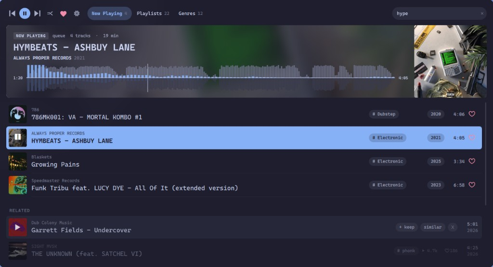
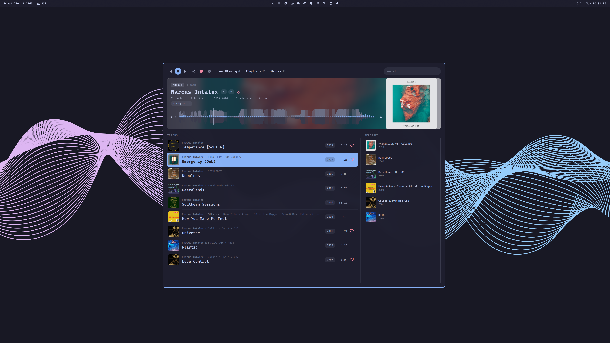
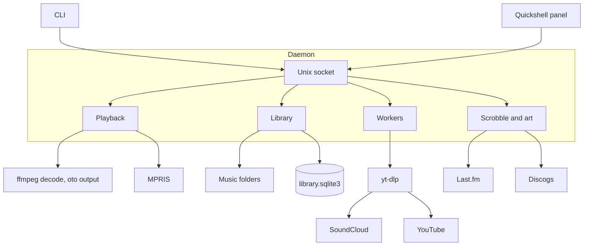

# Evoplayer

Inspired by Bjarne's terminal music player, I made a local player with just the features I want and use. I used Soundcloud for years and ignored my mp3 collection. This is so I enjoy my local library again.

The panel is Quickshell with a Go backend.

Related tracks are pulled from Soundcloud and can be added to the local library.

Genres, Artists, Albums, Labels and Years are all linked into their own pages.

Playlists are generated automatically from tags and likes. You can tag artists and albums as well as individual tracks.






## Layout

```
cmd/evoplayer/     thin main (serve, CLI)
server/            daemon, playback, library, ipc, cli
plugin/            quickshell panel
scripts/           install (binary, desktop entry, plugin link)
```

## Architecture

The panel and the CLI share one daemon. Requests are newline-delimited JSON on `$XDG_RUNTIME_DIR/evoplayer.sock`. The daemon pushes `state`, `viz`, `job`, and `warm` events back on the same connection.



Playback keeps the queue, EQ, and spectrum in-process and publishes MPRIS on the session bus. Library browse, tags, and playlists read the music tree and the SQLite cache under `~/.cache/evoplayer`. Downloads, likes import, and cache rebuilds run as worker processes. Secrets come from `pass` at daemon startup.

## Install

```bash
bash scripts/install
```

Puts `evoplayer` on `PATH` (`~/.local/bin/evoplayer` → `.build/evoplayer`).

## Usage

With no arguments, `evoplayer` opens the Quickshell panel and starts `serve` if the socket is missing. The panel is the `vendor/evoplayer` plugin in hyprdots. Toggle it with `evo ipc shell toggle evo.panels.player`.

### Player and daemon

```bash
evoplayer                    # open the panel (default)
evoplayer serve              # daemon only (playback, IPC, MPRIS, jobs)
evoplayer start              # start daemon if needed
evoplayer restart
evoplayer stop
evoplayer close              # stop playback
evoplayer version
```

### Transport

```bash
evoplayer toggle
evoplayer next
evoplayer prev
evoplayer seek <seconds>
evoplayer shuffle [on|off|toggle]
evoplayer volume <delta|set> [value]
evoplayer load <path> [--folder] [--json]
evoplayer status [--json]
evoplayer open [--json]
evoplayer playback <toggle|next|prev|stop|seek|volume|shuffle> …
```

### Queue

```bash
evoplayer queue append <path> [...]
evoplayer queue play <start-path> <path> [...]
evoplayer queue extend [--json]
evoplayer queue up-next [--limit N] [--json]
```

### Library

```bash
evoplayer browse <path> [--json] [--offset N] [--limit N]
evoplayer meta <path> [--json]
evoplayer genres [--json]
evoplayer tracks <genre> [--json]
evoplayer find <query> [--artist|--genre|--year|--album|--label <value>] [--json]
evoplayer cache [--force] [<genre>] [--prune-art] [--json]
evoplayer stats [--json]
evoplayer library browse|meta|import|cache|download …
```

### Downloads and jobs

```bash
evoplayer download [--import]                    # SoundCloud likes sync
evoplayer download <url> [--no-import]           # YouTube or SoundCloud URL
evoplayer discover [--json]                      # similar SoundCloud tracks for the current song
evoplayer discover keep|dismiss <id>
evoplayer job status|stop|cancel [--json]
```

### Playlists and favorites

```bash
evoplayer playlist [name] [--json] [--offset N] [--limit N]
evoplayer playlist create|rename|delete|star <name> …
evoplayer favorite <path>
evoplayer current [load|save|clear] [--json]
```

### Tags, art, and library tools

```bash
evoplayer tags read|standardize <path>
evoplayer tags sanitize|slugify <string>
evoplayer art search|set|apply|clear|maintain|notify-cache …
evoplayer sort <folder> [--json]
evoplayer vinyl by-label [root] [--execute]
evoplayer warm <path> [--json]
evoplayer warm --all [<folder>] [--json]
evoplayer warm --batch <paths...>
evoplayer placement log|undo-plan [--json] [--undoable] [--limit N]
```

### Scrobbling and history

```bash
evoplayer scrobble auth|token|nowplaying|submit|recent|touch …
evoplayer lastfm recording-mbid …
evoplayer history report [--json] [--week N] [--limit N]
evoplayer jsonlog scrobble-recent|queue-up-next …
```

### Config and viz

```bash
evoplayer config get|set|toml-get|toml-set|toml-json|toml-prune-derived|read-root|skip-dirs|pick …
evoplayer viz apply|stream [--fps N]|get
```

### Examples

```bash
evoplayer download https://soundcloud.com/you/likes
evoplayer cache --force drum&bass
evoplayer viz stream --fps 30
```

## Library folders

The music library is a tree of folders. Set the root with `evoplayer config set paths.root /path/to/music` (stored as `[paths] root` in `~/.config/evoplayer/music.toml`). Genre tag aliases for import live in the same file under `[genre_aliases]` (canonical keys like `drumandbass`) and `[genres]` (folder names like `drum&bass`). If unset or that folder is missing, evoplayer uses `~/music` or `~/Music`.

A genre tag is only a hint for which of those folders to use. Untagged downloads stay in `.incoming` until you pick a folder; import then moves the file into that folder (`youtube/` or `mixes/` plus year for long mixes).

## Credentials

The daemon loads secrets from `pass` once at startup, under `evoshell/` (override with `EVOPLAYER_PASS_PREFIX`), unless the environment variable is already set:

| Variable                                                    | pass entry                                                  | Used for                                                                                         |
| ----------------------------------------------------------- | ----------------------------------------------------------- | ------------------------------------------------------------------------------------------------ |
| `LASTFM_API_KEY`, `LASTFM_API_SECRET`, `LASTFM_SESSION_KEY` | `lastfm/api-key`, `lastfm/api-secret`, `lastfm/session-key` | Scrobbling (the daemon is the only scrobbler; failed submits retry from `scrobble-pending.json`) |
| `DISCOGS_TOKEN`                                             | `discogs/token`                                             | Discogs cover search                                                                             |

The SoundCloud token comes from Brave/Chromium cookies or pass. Daemon startup output goes to `daemon.log` in the state directory.